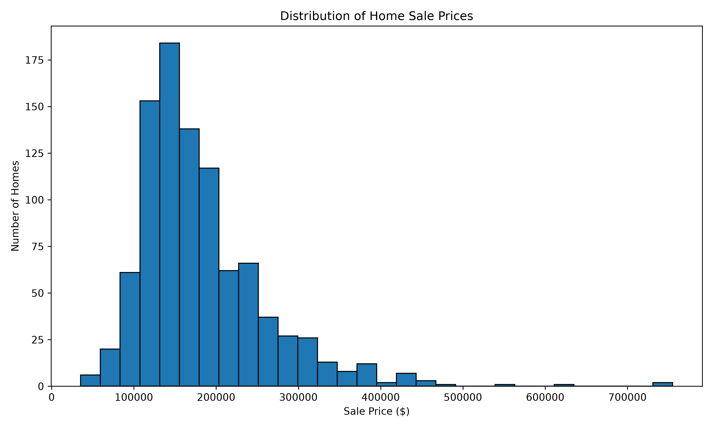
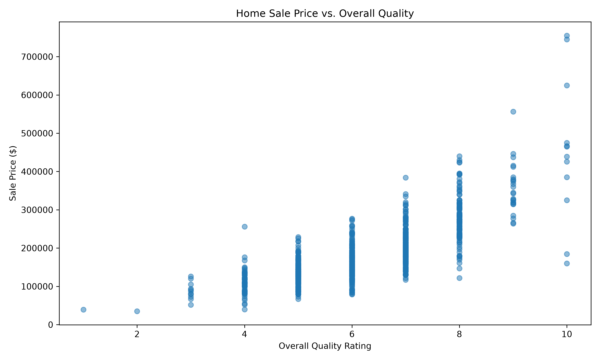
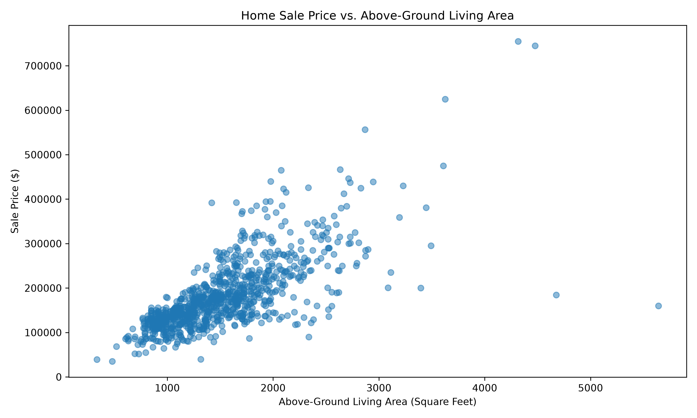

# Home Price Prediction Model Report

## 1. Project Overview

This project uses the Ames Housing dataset to predict residential home sale prices. The target variable is `sale_price`. A chronological split was used to train and evaluate models on progressively later sales.

| Dataset | Years | Records |
|---|---|---:|
| Training | 2006–2008 | 947 |
| Validation | 2009 | 338 |
| Testing | 2010 | 175 |
| **Total** | **2006–2010** | **1,460** |

Exploratory analysis used training data only.

## 2. Exploratory Data Analysis

**Sale Price Distribution**

Sale prices are right-skewed. Most homes sold between approximately $100,000 and $200,000, with a smaller number exceeding $500,000. These high-priced properties may contribute to larger prediction errors.

**Sale Price vs. Overall Quality**

Higher overall quality ratings are generally associated with higher sale prices. However, prices vary within each quality rating, indicating that quality alone does not explain sale price.

**Sale Price vs. Above-Ground Living Area**

Larger homes generally sold for more, although substantial price variation exists among homes with similar living areas. This suggests other property characteristics also influence sale prices.

## 3. Model Evaluation and Selection

Mean Absolute Error (MAE) was selected as the evaluation metric. MAE measures the average absolute difference between predicted and actual sale prices in dollars. Lower values indicate better predictions.

The baseline predicted the training-set average sale price ($182,104.54) for every validation observation.

| Model | Validation MAE |
|---|---:|
| Baseline | $59,407.42 |
| Linear Regression | $22,774.28 |
| Random Forest | $23,052.44 |
| **Gradient Boosting** | **$20,683.22** |

Gradient Boosting achieved the lowest validation MAE and was selected as the final model. Its validation error was approximately 65.2% lower than the baseline. Both Linear Regression and Random Forest also substantially outperformed the baseline.

## 4. Final Test Results

The selected Gradient Boosting model was evaluated on the held-out 2010 test dataset, which was not used for model selection.

- **Validation MAE:** $20,683.22
- **Test MAE:** $22,079.09

The test MAE was approximately 6.7% higher than validation MAE. This indicates reasonably consistent performance on unseen observations. On average, predictions differed from actual sale prices by approximately $22,079.

## 5. Feature Importance

The five most important features in the Gradient Boosting model were:

| Feature | Importance |
|---|---:|
| Overall quality | 54.86% |
| Above-ground living area | 21.04% |
| Garage capacity | 7.62% |
| Noridge neighborhood | 3.86% |
| House age at sale | 2.70% |

Overall quality and living area were the strongest contributors to model predictions. Feature importance measures the model's reliance on each variable; it does not establish causation.

## 6. Limitations and Conclusion

The model was developed using historical Ames Housing data, so its performance may not generalize to other housing markets. The exploratory charts show associations rather than causal relationships, and predictions may be less accurate for unusual properties.

An additional limitation is the use of 2023 Census socioeconomic information alongside home sales from 2006–2010. Because the Census information post-dates the sales, it may introduce temporal information leakage when simulating predictions that could have been made at the time of sale.

Overall, Gradient Boosting provided the strongest validation performance and achieved a test MAE of $22,079.09. Property quality and living area were the most influential predictors. Future improvements could include using socioeconomic data from years closer to each sale and testing the model on additional housing markets.# Home Price Prediction Model Report

## 1. Project Overview

This project uses the Ames Housing dataset to predict residential home sale prices. The target variable is `sale_price`. A chronological split was used to train and evaluate models on progressively later sales.

| Dataset | Years | Records |
|---|---|---:|
| Training | 2006–2008 | 947 |
| Validation | 2009 | 338 |
| Testing | 2010 | 175 |
| **Total** | **2006–2010** | **1,460** |

Exploratory analysis used training data only.

## 2. Exploratory Data Analysis

**Sale Price Distribution**

Sale prices are right-skewed. Most homes sold between approximately $100,000 and $200,000, with a smaller number exceeding $500,000. These high-priced properties may contribute to larger prediction errors.

**Sale Price vs. Overall Quality**

Higher overall quality ratings are generally associated with higher sale prices. However, prices vary within each quality rating, indicating that quality alone does not explain sale price.

**Sale Price vs. Above-Ground Living Area**

Larger homes generally sold for more, although substantial price variation exists among homes with similar living areas. This suggests other property characteristics also influence sale prices.

## 3. Model Evaluation and Selection

Mean Absolute Error (MAE) was selected as the evaluation metric. MAE measures the average absolute difference between predicted and actual sale prices in dollars. Lower values indicate better predictions.

The baseline predicted the training-set average sale price ($182,104.54) for every validation observation.

| Model | Validation MAE |
|---|---:|
| Baseline | $59,407.42 |
| Linear Regression | $22,774.28 |
| Random Forest | $23,052.44 |
| **Gradient Boosting** | **$20,683.22** |

Gradient Boosting achieved the lowest validation MAE and was selected as the final model. Its validation error was approximately 65.2% lower than the baseline. Both Linear Regression and Random Forest also substantially outperformed the baseline.

## 4. Final Test Results

The selected Gradient Boosting model was evaluated on the held-out 2010 test dataset, which was not used for model selection.

- **Validation MAE:** $20,683.22
- **Test MAE:** $22,079.09

The test MAE was approximately 6.7% higher than validation MAE. This indicates reasonably consistent performance on unseen observations. On average, predictions differed from actual sale prices by approximately $22,079.

## 5. Feature Importance

The five most important features in the Gradient Boosting model were:

| Feature | Importance |
|---|---:|
| Overall quality | 54.86% |
| Above-ground living area | 21.04% |
| Garage capacity | 7.62% |
| Noridge neighborhood | 3.86% |
| House age at sale | 2.70% |

Overall quality and living area were the strongest contributors to model predictions. Feature importance measures the model's reliance on each variable; it does not establish causation.

## 6. Limitations and Conclusion

The model was developed using historical Ames Housing data, so its performance may not generalize to other housing markets. The exploratory charts show associations rather than causal relationships, and predictions may be less accurate for unusual properties.

An additional limitation is the use of 2023 Census socioeconomic information alongside home sales from 2006–2010. Because the Census information post-dates the sales, it may introduce temporal information leakage when simulating predictions that could have been made at the time of sale.

Overall, Gradient Boosting provided the strongest validation performance and achieved a test MAE of $22,079.09. Property quality and living area were the most influential predictors. Future improvements could include using socioeconomic data from years closer to each sale and testing the model on additional housing markets.